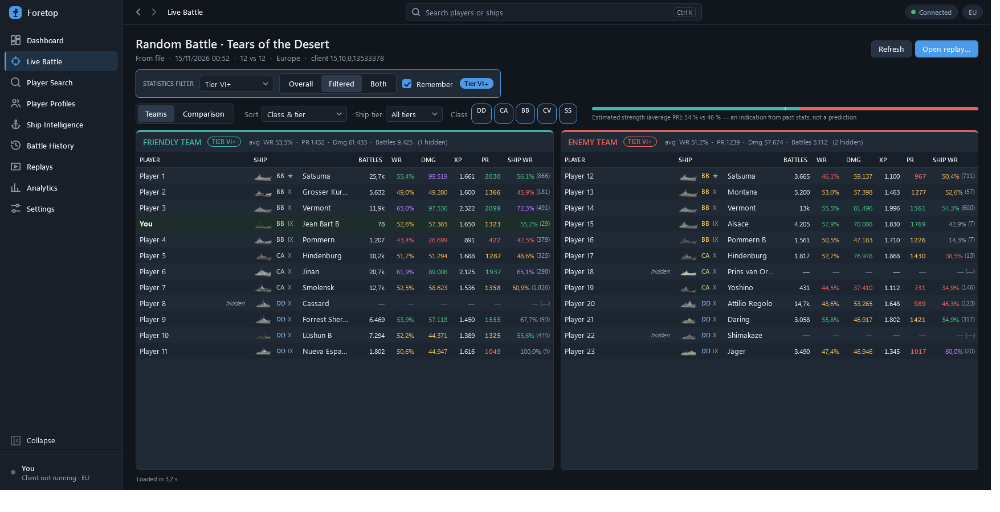
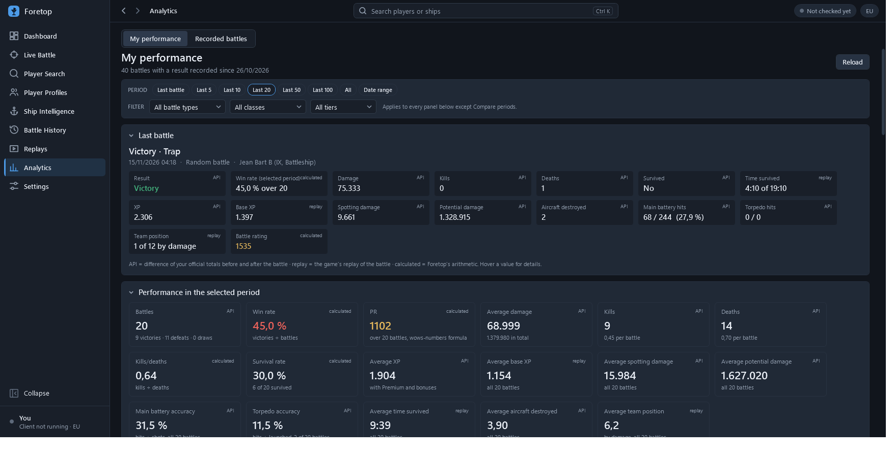
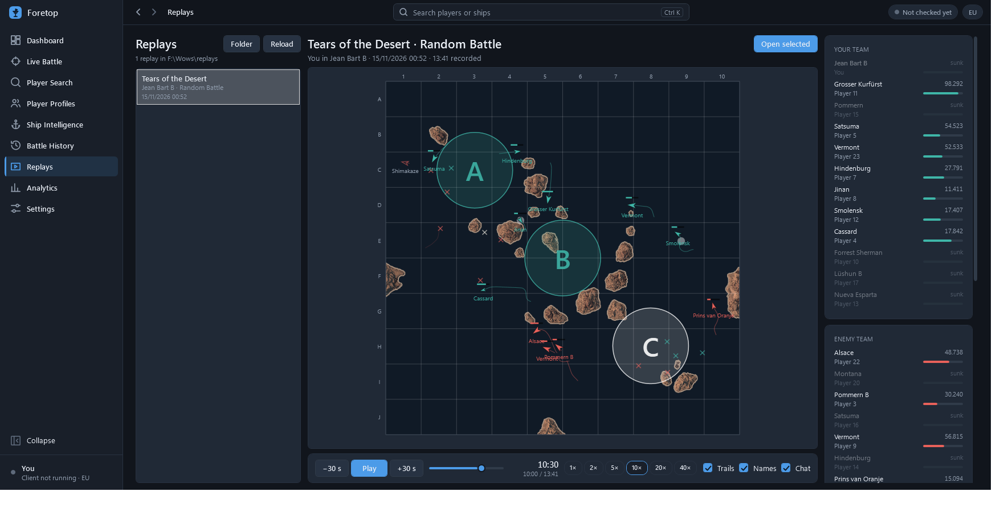
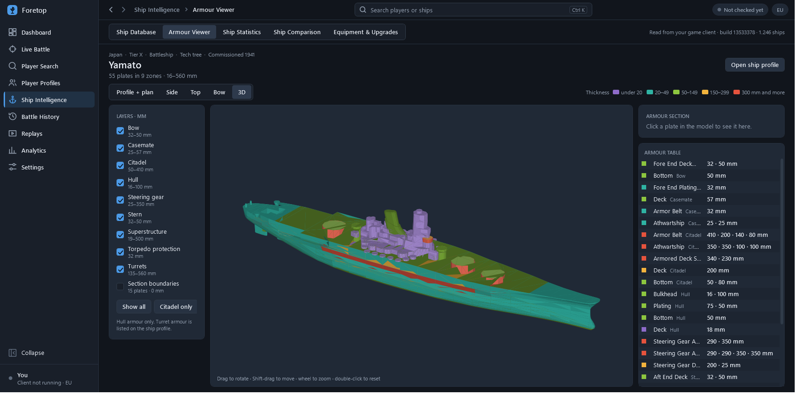
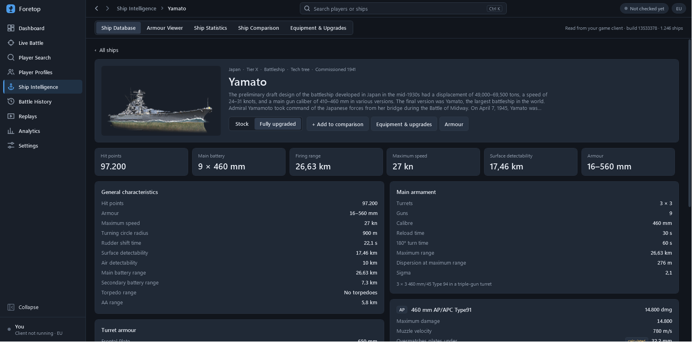
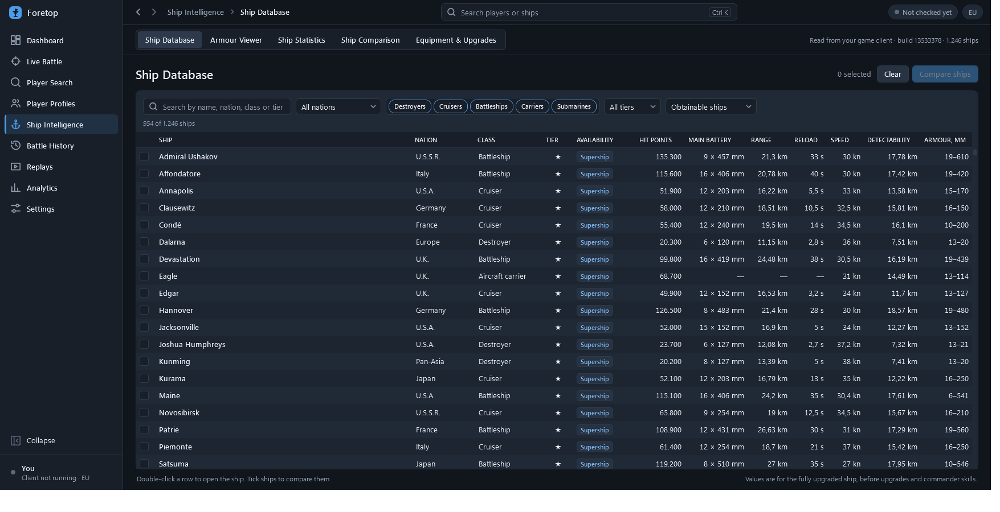

# Foretop

A Windows battle monitor for World of Warships. When a battle loads, it shows both
teams with each player's statistics from the official Wargaming API: win rate,
battles, damage, XP, Personal Rating, ship statistics and recent activity, plus team
comparison, player profiles, battle history, your own results and statistics. Ship
Intelligence reads every ship's characteristics and armour model from the installed
game, and the Replays page plays back your replays on the minimap, chat included.

It only reads files the game writes on its own (the battle roster, replays and the
game data). It does not touch the game process, memory or network traffic.

- **Using it:** [docs/USER_GUIDE.md](docs/USER_GUIDE.md)
- **Design and research:** [docs/ARCHITECTURE.md](docs/ARCHITECTURE.md)
- **Real-game test checklist:** [docs/TESTING.md](docs/TESTING.md)
- **Changes:** [CHANGELOG.md](CHANGELOG.md)

## Screenshots

**Live Battle**: both teams with each player's statistics as the battle loads, here counting only Tier VI+ battles.



**Analytics → My performance**: your own results over any period, with where each value comes from.



**Replays**: play back a replay on the minimap with ship tracks, capture points, kills and chat.



**Ship Intelligence**, read from the installed game: the armour model, ship profiles and a database of every ship.







<sub>Player names are replaced by "Player 1, 2…" and clan tags hidden (`--anonymize`). The My performance picture
shows sample battles; everything else is real game and API data.</sub>

## Download

**[Latest release](https://github.com/herades-sys/Foretop/releases/latest)**: Windows 10/11, 64-bit.

| File | Size | |
|---|---|---|
| [Foretop-1.9.0-x64.msi](https://github.com/herades-sys/Foretop/releases/download/v1.9.0/Foretop-1.9.0-x64.msi) | 57 MB | Installer, for your Windows account only (no administrator prompt), adds a Start menu entry |
| [Foretop-1.9.0-portable-x64.zip](https://github.com/herades-sys/Foretop/releases/download/v1.9.0/Foretop-1.9.0-portable-x64.zip) | 70 MB | Portable: unzip anywhere and run `Foretop.exe` |

Both are self-contained: no .NET install needed. Installing a newer MSI replaces the
old version and keeps your settings and history. From 1.4.0 on, Foretop finds new releases itself and
offers to install them (Settings → About → Updates).

The files are not code-signed, so Windows SmartScreen may say "Windows protected your
PC": click *More info* → *Run anyway*. To check a download, compare its SHA-256
(`Get-FileHash <file>` in PowerShell) with the release:

```
Foretop-1.9.0-x64.msi             83958E466E6CC0D3641FECD98C595E4709F19DE9C13BA96DF9DC9F4844C35243
Foretop-1.9.0-portable-x64.zip    5011E606F3BD1BD2ACA2DBB7B789FB5493E33FCC925C1519490F53E2004A87F1
```

## Install

Run the MSI, or unzip the portable version. To build the files yourself, see
*Develop* below; they land in `dist\`.

You also need:

- World of Warships with **replays enabled** (the default);
- a free **Wargaming application ID**: sign in at
  <https://developers.wargaming.net/applications/>, add an application of type
  *Mobile / Standalone*, paste the ID into Settings → Wargaming API.

## Licence

Foretop is licensed under the [Apache License 2.0](LICENSE). Copyright 2026 herades-sys.

Third-party parts keep their own licences: the .NET runtime and NuGet packages listed with their licences in
[THIRD-PARTY-NOTICES.txt](THIRD-PARTY-NOTICES.txt), which also ships with the app. Foretop contains no game
files or artwork; it reads them from your own World of Warships installation at run time. Foretop is not
affiliated with or endorsed by Wargaming.

## Develop

Requires the .NET 10 SDK on Windows.

```bash
dotnet build
```

```bash
dotnet test
```

```bash
dotnet run --project src/Foretop.App
```

Theme colours come from `docs/themes/themes.json` (`python tools/themes/make_theme_xaml.py` writes the XAML).

Release build (tests, self-contained publish, MSI via WiX 5 from NuGet, portable zip,
SHA-256 list) into `dist\`; the previous `dist\` is moved to `build\archive\`:

```bash
powershell -ExecutionPolicy Bypass -File build\build.ps1
```

The icon is generated by `build\make-icon.ps1`. Version: `Directory.Build.props`.

### Layout

```
src/Foretop.Core     game detection, API client, cache, statistics (no UI)
src/Foretop.App      WPF app (MVVM), themes, charts
tests/Foretop.Tests  xUnit tests
installer/             WiX 5 MSI
build/                 release and icon scripts
docs/                  architecture, user guide, test checklist
archive/               replaced files, kept by project rule
```

### Data at runtime

`%LOCALAPPDATA%\Foretop`: `foretop.db` (cache and battle history),
`settings.json` (application ID DPAPI-encrypted), `logs\`, `icons\` (ship icon cache)
and `archive\` (a damaged database is moved there, never deleted).

### Developer switches

```bash
Foretop.exe --open path\to\file.wowsreplay --page Live --snapshot out.png --wait 3
```

`--snapshot` renders the window to a PNG and exits (UI checks without the game; also
skips the single-instance guard). Also: `--profile <name>`, `--compare`,
`--open-latest-history`, `--scroll <px>`, `--light`, `--switch-theme <Dark|Light>`, `--startup-screen` (show it in a development run), `--startup-snapshot <png>`
(save the startup screen once its checks are done),
`--diag` (logs memory every 30 s), `--software` (software rendering).
Ship Intelligence (applied once the ship data is loaded): `--ship <name>`,
`--compare-ships "A;B;C"`, `--ships-section <Database|Armour|Statistics|Comparison|Equipment>`,
`--armour-view <Profile + plan|Side|Top|Bow|3D>`, `--plate <key>`, `--citadel-only`,
`--account <name>` (session only, not saved).
Others: `--data-dir <folder>` (use another data folder, so test runs never touch your real settings and database),
`--anonymize` (player names → "Player 1, 2…", no clan tags; for screenshots), `--stats-filter <min tier>`,
`--stats-view <Overall|Filtered|Both>`, `--replay <path|latest>` (any folder), `--replay-time <s>`, `--replay-debug`, `--replay-full`, `--replay-zoom <z>[,x,z]`,
`--render-minimap <WxH,…> <folder>`, `--window <WxH>` (may exceed the monitor), `--analytics-source <Account|Recorded>`, `--analytics-tiers 8,10`,
`--analytics-min 20`, `--analytics-class Battleship`, `--player-search <text>`, `--soak <minutes>` (long-session test, needs
`--data-dir`), `--update-feed <json>`,
`--update-panel`, `--enrich-now`, `--sidebar-collapsed`, `--ship-filter 8,10,BB`, `--best-tiers 8,9`, `--best-min 50`, `--font <family>`, `--text-scale <1.25>`.

Foretop is not affiliated with or endorsed by Wargaming. World of Warships is a
trademark of Wargaming. Personal Rating expected values: wows-numbers.com. Karma: WoWS Karma (wows-karma.com).
